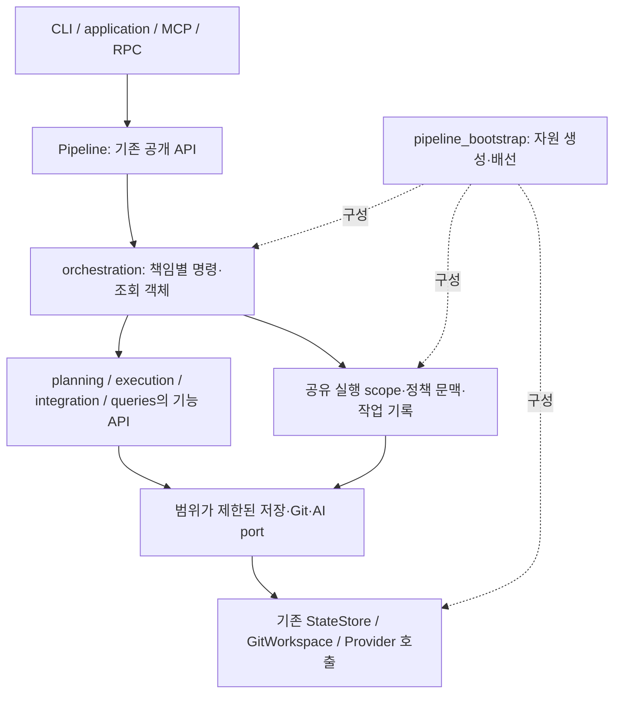

# Pipeline 재설계: 명시적 진입점과 명령 소유권

- 작성일: 2026-11-15
- 상태: **P1~P5 적용 완료. 공개 API 112/112개 이전, facade 977줄.**
- 구현 순서: [5단계 이행 계획](../../Plan/2026-11-15-pipeline-orchestration-redesign.md)
- 전체 공개 API 배정: [112개 API 소유권 표](2026-11-15-pipeline-api-ownership.md)
- 내부 소유권: [376개 private 표와 자원·잠금·테스트 hook](2026-11-15-pipeline-private-ownership.md)
- 현재 기준: [아키텍처](../../../Docs/Architecture.md), [검증 규칙](../../../Docs/Testing.md)

## 결정

Pipeline을 계속 작은 함수로 쪼개지 않고 **공개 진입점, 명령 조정, 기능 서비스, 자원 구성**으로 나눈다.
`pipeline.py`는 기존 생성자와 112개 공개 메서드를 유지하는 얇은 facade로 만들며 **1,000줄 이하**를 목표로 한다.
상태·승인·잠금·SDK/Git의 최종 판단은 Python 코어에 유지하되, 한 클래스가 모두 구현해야 한다는 조건은 해제한다.
현재 문서의 “Pipeline이 소유한다”는 실행 조정 책임을 이행 단계별로 명령 소유자와 runtime에 명시적으로 배정한다.
줄 수만 줄이는 mixin/상속 분할·동적 forwarding·서비스 locator·전체 Pipeline/Store를 넘기는 context는 사용하지 않는다.

설계 승인 후 P1~P5를 구현했다. 아래 구조와 책임 배정은 적용한 상태이며 실제 증거/제한은 이행 계획을 따른다.
UI·Electron/JSON Lines RPC·MCP·CLI, 모듈러 모놀리스와 로컬 저장 구조를 바꾸지 않는다. Rust 프로젝트는 범위 밖이다.

## 현재 구조에서 확인한 문제

| 2026-11-15 실측 | 값 | 의미 |
|---|---:|---|
| `pipeline.py` | 5,495줄 | 기능 함수 이동 이후에도 조정과 조립이 집중돼 있다 |
| 직접 정의 메서드 | 411개 | 공개 112개, private 299개 |
| 별도 private 호출 표면 | static/class 별칭 75개와 instance runtime endpoint 2개 | 위 299개와 별도로 이전 대상에 포함해야 한다 |
| 공개 메서드의 현재 구현 | 1,707줄 | 단순 wrapper보다 많은 흐름/검증이 남아 있다 |
| 공개 signature/decorator | 299줄 | 112개 API를 명시해도 1,000줄 목표는 현실적이다 |
| class 이전 header/import 등 | 362줄 | feature별 생성자·호환 이름이 facade 파일에 남아 있다 |
| `self.store` 참조 | AST 615개 | 읽기/쓰기/잠금 조합이 집중돼 있다. 615개의 쓰기라는 뜻은 아니다 |
| 테스트 private callable hook 대체 | 별칭 포함 AST 후보 360곳/57개 이름 | 구현 구조가 테스트용 패치 경계에 묶여 있다 |

private 호출/참조의 전이 도달성을 보면 107개는 한 API 소유권 묶음에서만, 175개는 여러 묶음에서 도달한다.
17개는 이 분석으로 도달하지 않는다. `self` 메서드 참조만 분석한 결과여서 **공유 서비스 175개가 필요하거나
17개가 미사용이라는 판정이 아니다.** class 별칭/외부 호출/테스트/동적 callable은 별도로 확인한다.

현재 module import가 순환한다는 근거는 없다. 다만 `_planning_source_indexes ↔ refresh_planning_index`,
`_archive_cleanup_workflow ↔ _apply_archive_cleanup`처럼 factory가 다시 facade callback을 받는 참조 고리가 있다.
이것은 무한 재귀 버그 판정이 아니라 **기능 내부 협력이 Pipeline을 경유하는 조립 구조**의 예다.

따라서 위임을 몇 줄씩 더 이동하거나 private 호환 이름을 계속 추가하는 방식으로는 종료하기 어렵다.
테스트 hook도 새 소유자의 공개 port로 옮기고, 구현/조립/호환의 소유권을 함께 바꿔야 한다.

## 목표 구조와 의존 방향



`application.runtime.create_pipeline`은 기존처럼 Pipeline을 만든다. 기존 `Pipeline(config, ...)` 생성자도 유지한다.
생성자 안에서는 bootstrap을 호출하고 명령 객체를 배치한다. bootstrap은 Pipeline을 import하지 않는다.

```text
src/ai_orchestrator/
  pipeline.py                      기존 공개 signature·명시적 delegation·필수 호환 export
  pipeline_bootstrap.py            자원/port/실제 객체 구성. 업무 분기·실행·저장 없음
  orchestration/                   아래 8개 객체. __init__에서 application/Pipeline eager import 금지
    planning.py                    PlanningCommands
    execution.py                   ExecutionCommands
    control.py                     RunControlCommands
    integration.py                 IntegrationCommands
    lifecycle.py                   LifecycleCommands
    effort.py                      EffortCommands
    queries.py                     RunQueries
    providers.py                   ProviderQueries
  planning/                        기존 기능 + 기획 정책 scope/공통 phase API
  execution/                       기존 기능 + 필요한 Run step lifecycle
  integration/                     기존 Git/검증/보관 기능
  persistence/                     기존 StateStore로 연결하는 제한된 port adapter
```

- facade → 명령 객체 → 기능 API가 기본 호출 순서다. 같은 API에 “위임용 facade”만 한 겹 더 만들지 않는다.
  명령 객체는 실제 승인·잠금·호출 순서·실패 처리를 소유한다. 기존 기능 서비스는 규칙/phase를 수행한다.
- feature는 Pipeline, bootstrap, `application` 또는 명령 객체를 역참조하지 않는다. 기능 내부 협력은
  해당 기능 API를 직접 호출한다. 조립을 위해 수십 개의 `self._...` callback을 다시 넘기지 않는다.
- bootstrap은 Config/StateStore/Git/SDK를 명시적으로 구성할 수 있는 위치다. feature에는 기존의 좁은
  records/port와 필요한 설정값만 넘긴다. bootstrap의 전체 자원 묶음을 context로 전달하지 않는다.
- 구성 결과를 묶더라도 구체적인 객체 field만 가진 내부 결과값으로 제한한다. `resolve(name)`, 등록/탐색,
  `__getattr__` dispatch, 임의 factory 조회를 제공하거나 그 묶음을 feature에 주입하지 않는다.
- `orchestration`은 새 서비스/프로세스 경계가 아니다. 호출은 모두 동일한 Python 코어 안에서 이뤄진다.

## 공개 명령의 소유권

| 목표 객체 | API 수 | 책임 |
|---|---:|---|
| PlanningCommands | 26 | 준비/생성·대화·미리보기·계획/기술 구성 확정·결과 수정 요청 |
| ExecutionCommands | 16 | 실행/재개·개별 재시도·수동 인계·Task 프로필/사용자 확인 |
| RunControlCommands | 16 | 요청/중단·대화 관제·잠금 복구·복구 operation |
| IntegrationCommands | 21 | 검증·Main 변경/반영·충돌·결과·push/deploy |
| LifecycleCommands | 6 | 보관/삭제·정리·작업공간 상태 |
| EffortCommands | 6 | 강도 정책 선택·예약·계획 적용과 관련 조회 |
| ProviderQueries | 5 | AI 연결/가용성·계정 한도 |
| RunQueries | 16 | 상태/목록/알림·로그·사용량·환경 진단 |
| 합계 | 112 | 이름·인자·기본값·반환/오류 유지 |

전체 이름은 [API 배정표](2026-11-15-pipeline-api-ownership.md)에 중복 없이 기록했다.
읽기처럼 보이는 이름으로 구현을 분류하지 않는다. `recovery_plan`은 operation을 기록하므로 제어 명령이고,
`main_changes(refresh_remote=True)`는 Git 조회/원격 갱신 경계를 가지며, `check_dotnet`은 subprocess를 실행할 수 있다.

각 명령 객체가 다시 거대 클래스가 되면 실제 흐름별 기능 API로 나눈다. 예를 들어 IntegrationCommands는
Main 반영/검증/결과 전달을 기존 서비스로 조합한다. 모든 private 코드를 한 클래스에 복사하지 않는다.
파일 500~700줄은 검토 신호이며 기계적인 분할 기준은 아니다. 실제 transaction을 중간에서 끊어서는 안 된다.

## 상태·저장·자원 소유권

| 항목 | 목표 소유자 | 보존해야 할 조건 |
|---|---|---|
| Run별 상태 전이·실패/rollback | 해당 요청의 명령/phase 소유자 | RunState의 기존 전이 API와 저장 순서, 금지 단계/보관 보호 |
| StateStore/GitWorkspace 생성 | bootstrap, 제한된 adapter | 현재 Pipeline 인스턴스 기준 생성·notification callback, 기존 파일/참조 형식 |
| run/project/chat/request 잠금 | 기존 StateStore 구현, 명령 흐름이 획득 | 획득/해제 위치·순서·scope와 실제 파일 잠금 유지 |
| 실행 세션/중단·프로세스 소유권 | 기존 ExecutionControlService 등 실행 수명 API | PID/attempt/invocation·체크포인트·종료 확인과 finally 정리 |
| `_step`의 단계/검증 시도 기록 | RunStepLifecycle 역할의 기능 API | 기존 실패/중단/stale/성공 순서와 성공 후에만 그룹 결과 기록 |
| Planning 정책 scope | 기획 정책 수명 API | 인스턴스별 ContextVar 하나·nested 재사용·prepare/finish와 reset 순서 |
| Task 진행 공유 잠금 | 인스턴스별 runtime의 동일 RLock | 여러 명령 객체에서 동일 자원을 사용. 객체마다 별도 lock을 만들지 않음 |
| SDK/credential 참조 | 요청 runtime, SDK 실제 owner는 기존 진입점 | key snapshot·SDK 미생성/미소유·종료 주체, progress/usage/cancel 전달 |
| 검증/통합/Git 쓰기 | integration의 실제 기능 API와 요청 명령 | 승인·HEAD/revision/경로 재검증과 부분 실패 receipt |
| 조회와 표시 | 조회 객체·기존 query 서비스 | unknown/None/0과 오류 전파·정렬/시간 예산을 유지 |

큰 공용 `RunContext`에 위 항목과 모든 명령을 모으지 않는다. ContextVar·저장 adapter·실행 세션은
서로 구별된 자원/port다. 기존 ExecutionControlService, TaskActivityRecorder, ProviderRuntime,
WorkspaceLifecycle 등을 재사용하고 같은 책임의 “공통 kernel”을 중복으로 만들지 않는다.

`_step` 94줄을 그대로 기능 소유자에 옮기는 것은 허용한다. 그 함수가 한 transaction을 설명한다면
줄 수만 맞추기 위해 예외/성공 경계를 여러 callback으로 나누지 않는다. kernel이 모든 업무 전이를 결정하지도 않는다.

## 기능을 가로지르는 흐름과 잠금

명령 객체 사이의 무조건적인 상호 호출은 금지한다. 공통 실행 부분은 **기존 기능의 phase API**로 소유자를 정한다.
공개 명령은 필요한 잠금을 획득하고, `*_locked` phase API는 이미 확보한 scope 안에서 실행한다.
같은 잠금을 다시 잡는 공개 API를 내부 실행용 callback으로 연결하지 않는다. 공개 호출이 원래 잠금 밖에
있던 경우만 그 위치를 그대로 보존한다. 모든 API에 일괄 lock decorator를 붙이지 않는다.

| 실제 확인한 흐름 | 보존할 호출/잠금 경계 | 목표 협력 |
|---|---|---|
| 검증 성공 → 신규 프로젝트 기능 기획 | verify의 run lock·execution session 안에서 chat lock 추가 | IntegrationCommands가 VerificationFlow와 PlanningFeatureFlow를 같은 순서로 호출 |
| 실행 batch 뒤 방향 수정 대기 | 기존 실행 경계에서 현재 상태 재조회 후 chat lock·다음 Task 중단 | 실행 소유자가 PlanningChangeFlow의 잠금 계약을 명시적으로 사용 |
| 관제의 계속/검증/범위 승인 | 기존 대상 검증·계획 확정 위치와 run/session 순서 | RunControlCommands가 실행/검증의 phase API를 호출하며 facade로 돌아오지 않음 |
| 보관 | project Git → run → chat 잠금, 기록 선보존 후 정리 | LifecycleCommands가 기존 RunArchiver/ArchiveCleanupWorkflow를 조합 |
| Planning 답변 중단 | 소유 record 확인 후 요청 잠금을 풀고 종료 확인, 마지막 기록 시 다시 획득 | 전체 함수를 하나의 request lock으로 감싸지 않음 |

의존하는 phase API가 아직 Pipeline에 있으면 그 API를 처음 사용하는 이행 단계에서 함께 옮긴다.
해당 기능의 공개 wrapper 배정 차례까지 기다리거나 새 facade-back-callback을 만들지 않는다.
새 공통 API는 실제 소비자가 있는 경우만 만든다. 준비용 빈 패키지·placeholder는 만들지 않는다.

## 호환과 테스트 경계

### 유지할 계약

- `Pipeline(config, *, codex_sdk, dotnet_executable, code_style_preference, code_style_preference_revision,
  account_usage_reader)`의 선택 인자는 현재 `None`, `""`, `None`, `0`, `None` 기본값을 각각 유지한다.
  공개 API 112개의 signature/반환/오류도 유지한다.
- 현재 src/tests에서 `pipeline` 모듈로 import하는 16개 이름도 첫 계약 목록에 포함한다.
  Pipeline/오류 클래스와 Task 검증 오류·UsageContext, 기존 timeout/로그/AGENTS 상수의 객체/값을 유지한다.
  알려지지 않은 외부 소비자가 없다고 가정해 module export를 무작정 지우지 않는다.
- 공개 static API는 전체 runtime을 만들지 않아도 호출할 수 있어야 한다. 예: `Pipeline.account_usage`와
  user check 순수 조회. 명령 객체 생성이나 SDK 초기화를 추가하지 않는다.
- 저장 형식·파일명·request ID/digest/revision·RPC method/field/enum, 승인 문구·중단/취소·오류 원인·시간 의미는 변경하지 않는다.
- `config/store/git/agents/dotnet_executable` 등 현재 보이는 속성의 접근도 이행 중 유지한다. 인스턴스 생성 후
  재할당하는 테스트 후보가 29곳 있다. 초기 bound method를 영구 capture해 이 동작을 우연히 바꾸지 않는다.
  자원 owner의 명시적 compatibility property/좁은 adapter 조회로 연결하고 재설정 시 기존에 없던 재구성을 하지 않는다.
  전체 자원 owner는 bootstrap/facade 내부에만 두며 feature constructor에 넘기지 않는다.

### 이전할 내부 계약

- private 299개·별칭 75개·runtime endpoint 2개는 영구적인 facade API로 보존하지 않는다. 각각 기능/phase/
  runtime의 소유자를 정하거나 실제 소비자가 없음을 확인한다. AST에서 도달하지 않는다는 이유만으로 삭제하지 않는다.
- 특히 `_build_plan` 54곳, `_invoke_agent` 52곳, `_resolve_executable` 36곳, `_invoke_provider_command` 34곳 등
  기존 테스트 패치를 실제 소유자의 명시적 port나 생성 시 주입하는 fake로 옮긴다. 이 수치는 AST 후보이며 런타임 호출 수가 아니다.
- 이미 있는 테스트의 Task/Run·receipt/예외·rollback 기대를 유지한다. 패치 대상만 새 소유자로 옮기며
  테스트를 skip/삭제하거나 검증을 약하게 만들어 구조 변경을 통과시키지 않는다.
- 기능 단위 테스트는 새 명령/기능 객체를 좁은 fake port로 만든다. 전체 Pipeline을 fake context로 주입하지 않는다.
  소수의 facade 통합 검사는 기존 생성자를 통해 실제 배선을 검증한다. 테스트용 옵션을 사용자 UI/설정에 추가하지 않는다.
- 임시 compatibility binding이 필요하면 실제 기존 소비자와 제거할 이행 단계를 기록한다. 완료된 기능의
  명령이 다시 `self._legacy...`로 Pipeline을 경유하는 구조를 최종 상태로 남기지 않는다.

## 구성과 오류 처리의 제한

- bootstrap은 설정/자원/port를 만들고 실제 객체를 연결한다. Run 전이·operation claim·Git 쓰기·AI 호출은 수행하지 않는다.
- resource/adapter는 scope에 필요한 공개 동작만 제공한다. `context.store`, `context.pipeline`, 임의 method lookup은 금지한다.
- 현재 facade에 정의된 `ApprovalRequired`는 오류 소유 모듈로 옮기고 원래 import 경로로 re-export한다.
  명령 객체가 예외를 가져오려고 facade를 역참조하게 두지 않는다. `_StoredStopSignal`도 load-control port를
  받는 실행 제어 소유자로 옮겨 전체 StateStore 참조를 제거하며 scope/실행·Task·attempt/invocation 일치 판정을 유지한다.
- 단일 제품의 기존 SDK/notification/ContextVar·lock을 중복 생성하지 않는다. credential은 기존 요청 snapshot을
  유지하며 로그/DTO/설계 자료로 출력하지 않는다. 새 DB/HTTP 서비스/메시지 버스/외부 의존성을 도입하지 않는다.
- replay의 성공/실패·queued 의미, 원래의 예외 경계와 `raise ... from` 원인, 오류 상태와 빈 결과의 차이를 유지한다.
- 이행 중 같은 요청에 구/신 경로를 모두 실행해 비교하지 않는다. 하나의 명령은 하나의 owner로만 dispatch한다.
  비교가 필요하면 순수 snapshot·fixture·AST 또는 별도 fake에서 하고 실제 Git/AI 부작용을 이중 실행하지 않는다.

## 대안 검토

| 대안 | 판단 |
|---|---|
| private 함수를 계속 이동하고 같은 facade wrapper 추가 | 조립/테스트 결합이 남는다. 반복하지 않음 |
| Planning/Execution/Integration mixin·파일 분할 | 동일 self/권한이 모든 파일에 남는다. 사용하지 않음 |
| 모든 것을 받는 Kernel/Context·service locator | 결합을 숨기고 새로운 거대 객체를 만든다. 사용하지 않음 |
| Rust 재작성·새 프로세스/네트워크 계층 | 현재 요청에 필요하지 않고 저장/배포 부담이 크다. 범위 밖 |
| 명시적 facade + 책임별 명령 + 제한된 port + bootstrap | 선택. 공개 계약을 유지하면서 실제 소유권/테스트 경계를 바꿀 수 있음 |

## 완료 기준

1. 공개 API 112개가 소유권 표와 일치하고 constructor/16개 import 계약·RPC/모델/저장 계약이 보존된다.
2. Pipeline은 구성 호출·필수 compatibility property와 명시적 delegation만 수행한다. 업무별 lock·상태 전이/
   Git/AI 호출·feature factory를 직접 구현하지 않는다. private 299개/별칭 75개/endpoint 2개의 이행이 기록된다.
3. 현재 공개 signature 299줄을 기준으로 `pipeline.py` **1,000줄 이하**를 목표로 한다. 줄바꿈 압축/타입 생략으로
   맞추지 않는다. 넘으면 남은 실제 책임을 재검토하며 “wrapper라 어쩔 수 없다”로 종료하지 않는다.
4. feature/명령 객체에서 facade/bootstrap/application으로 역참조하지 않는다. 필요한 데이터/기능 port와 잠금 계약이 명시된다.
5. bootstrap이나 다른 coordinator 하나에 5천 줄을 그대로 옮기지 않는다. 명령마다 한 owner, 공유 자원마다 한 소유자를 유지한다.
6. 영향받은 정적/계약·선택 회귀 검사가 통과하고 compatibility bridge의 제거 항목·알려진 필수 결함이 남지 않는다.

전체 테스트·빌드/패키징·실제 AI/제품 화면·공개 저장소/릴리스는 매 단계 기본 검사가 아니다.
필요한 이유가 있는 경우에만 해당 범위를 선택한다. 최초 설계 작성은 문서 검사만 수행했다.
실제 구현/통과 증거와 소유권 표의 갱신은 [이행 계획](../../Plan/2026-11-15-pipeline-orchestration-redesign.md)에 기록한다.

## 분석 범위와 구현 전 확인 사항

- 메서드/참조·private hook/공개 속성 재할당 수치는 현재 저장소의 AST에서 얻은 정적 조사다.
  실제 객체 타입을 모두 추론한 런타임 trace나 저장소 전체의 결함/성능 검증은 아니다.
- 현재 CLI/application/MCP 소스에서 이름이 `pipeline`인 receiver의 private/원시 자원 접근은
  관찰되지 않았다. 다른 alias·외부 Python 소비자·상속 확장 계약까지 없다고 단정하지 않는다.
  P1에서 src/tests의 import·속성/확장 사용과 각 API의 실제 부작용/잠금 표를 확정한다.
- 위 잠금 표는 확인한 대표 흐름이다. 새 공통 scope로 바꿔도 된다는 허가는 아니다. 이행하는
  각 명령에서 lock 전후 I/O·예외/취소·rollback 순서를 기존 코드와 대조한다.
- 1,000줄은 공개 선언 299줄에서 산정한 facade 목표다. 구현이 완료된 측정값이나 성능 보장이 아니다.
  설계 단계에서 발견하지 못한 실제 호환 계약이 있으면 그 계약을 먼저 기록하고 구조/범위를 조정한다.
